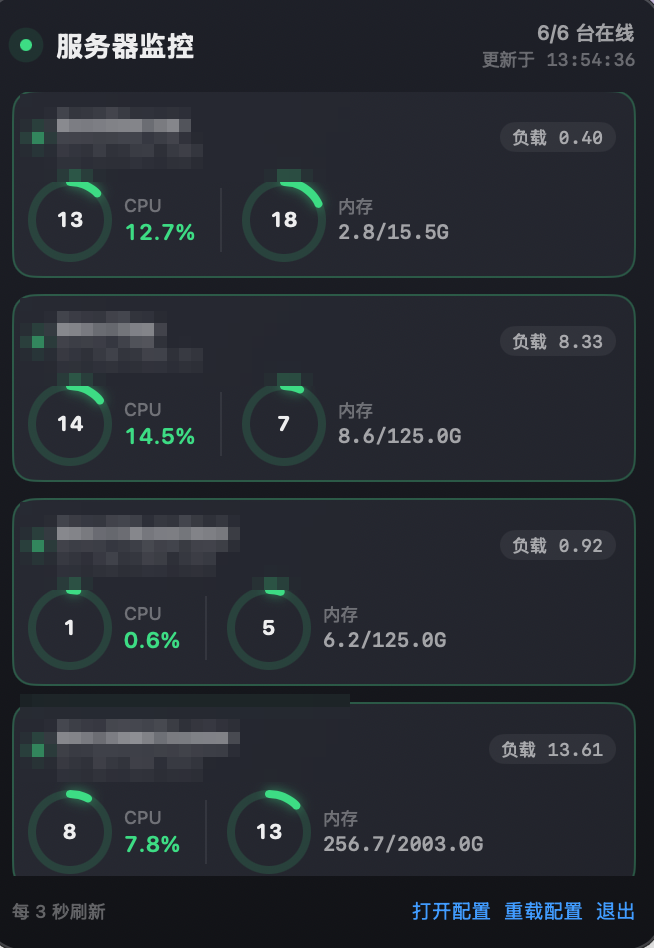

# ServerMonitor

**A macOS menu bar dashboard for monitoring your Linux servers' CPU & memory — zero deployment, just SSH.**

常驻 Mac 菜单栏的服务器监控小工具：自动读取 `~/.ssh/config`，通过 SSH 并行采集所有机器的实时 CPU / 内存 / 负载，点击图标一屏看全。



## 特性

- 🖥 **菜单栏常显**：实时显示全部机器中最高的 CPU% / 内存%，≥70% 变橙、≥90% 变红；鼠标悬停可看摘要
- 📋 **全量一览面板**：每台机器一张卡片——环形仪表、内存用量、1 分钟负载，并行采集互不阻塞
- 🔀 **自适应布局**：机器数量变化时自动重排（≤6 台单列 / 7~14 台双列 / >14 台三列），更多则面板内滚动
- 🧹 **自动去重**：`~/.ssh/config` 里多条目指向同一台机器（地址+端口相同）时只显示一个卡片；支持 `Include`
- 🎯 **可排除**：`config.json` 的 `ignore` 里写上别名或 HostName，就不监控那台机器
- 🔔 **掉线一目了然**：连不上的机器立刻从在线数里扣掉，卡片标「已离线」，掉线前的数据灰显并注明时间，菜单栏追加 ⚠︎
- 🔐 **不替你信任主机**：指纹没确认过的机器标「未信任」并给出该执行的 ssh 命令，不会自动写入 known_hosts
- 🚀 **零部署**：服务器端无需安装任何东西，每次采集只是一条只读 SSH 命令

## 环境要求

- macOS 12 或更高版本，Apple Silicon 与 Intel 通用
- 目标服务器为 Linux（读取 `/proc`），且已配置 SSH 免密登录。其他系统会显示为「不支持」，不算故障：

```bash
ssh-keygen -t ed25519        # 已有密钥可跳过
ssh-copy-id user@your-server # 输入一次密码
ssh user@your-server         # 确认不再要密码
```

> 兼容性说明：构建目标是 macOS 12 + 双架构，但实际只在 macOS 26（Apple Silicon）上运行测试过；
> Intel 切片只在 Rosetta 下验证过能启动和采集，更低版本的系统和 Intel 实机没有测过，遇到问题欢迎提 issue。

## 安装

**方式一：下载 DMG**（Releases 页面）

打开 DMG，将 ServerMonitor 拖入 Applications。

**方式二：源码构建**

```bash
git clone <repo-url> && cd server-monitor
./build.sh 1.0.0     # 产出 build/ServerMonitor.app 与 build/ServerMonitor-<版本>.dmg
open build/ServerMonitor.app
```

> 开机自启：系统设置 → 通用 → 登录项，添加 ServerMonitor。

## 使用

工具启动后自动读取 `~/.ssh/config` 里的主机（包括 `Include` 进来的文件）并开始监控。
`Host` 行里带通配符或以 `!` 开头的名字（如 `Host *`、`Host * !foo` 里的 `*` 和 `!foo`）是规则而不是具体机器，会被跳过。例如：

```
Host *                       # 全局默认设置，不会被当成机器
  ServerAliveInterval 60

Host web                     # 命名别名
  HostName 203.0.113.10
  User deploy

Host 203.0.113.10            # 和 web 是同一台机器的两个条目，只会显示一个
  User deploy

Host github.com              # 不是 Linux 服务器 → 显示「不支持」，可以加进 ignore
  User git
```

自定义配置（可选）— 编辑 app 同目录或源码目录的 `config.json`：

```json
{
  "interval": 3,
  "columns": 0,
  "ignore": ["github.com"]
}
```

| 字段 | 说明 |
|---|---|
| `interval` | 采集间隔（秒） |
| `columns` | 面板列数；`0` = 按机器数自动（≤6:1 列、7~14:2 列、>14:3 列），可填 `1`~`4` 固定 |
| `ignore` | 不监控的机器，填 ssh config 里的别名或 HostName 均可，不分大小写；按整台机器排除 |

往 `~/.ssh/config` 增删机器后，面板内点「重载配置」（⌘R）即生效，无需重启。

## 采集原理

每 `interval` 秒对每台机器并行发起一次 SSH（`ssh 别名`，User / Port / 密钥 / 主机指纹校验全部沿用 ssh 自己的配置），在服务器上执行：

```sh
test -r /proc/stat || { echo __NOT_LINUX__ "$(uname -s)"; exit 42; }  # 读不到 /proc 就报出系统名
head -1 /proc/stat; sleep 1; head -1 /proc/stat
grep -E '^(MemTotal|MemAvailable):' /proc/meminfo
cat /proc/loadavg
```

- **CPU**：两次 `/proc/stat` 采样差值 → 真实区间占用率（非瞬时值）
- **内存**：`(MemTotal − MemAvailable) / MemTotal`
- **负载**：1 分钟 load average
- 全部为只读命令，对服务器零侵入

## 常见问题

- **卡片显示「连接失败」或「已离线」**：鼠标悬停卡片看具体原因，通常是网络不通，或没配免密（`Permission denied`）。
  「已离线」表示之前连得上、现在连不上；卡片上的数字是掉线前的，已经灰显并注明时间，也不计入在线数。
  工具使用 BatchMode，不会弹密码框。
- **卡片显示「未信任」**：这台机器的主机指纹还没确认过。在终端执行一次 `ssh 别名` 完成确认，下一轮采集就会恢复。
  工具不会自动信任没见过的主机，这是有意为之。
- **卡片显示「不支持」**：目标不是 Linux，或者读不到 `/proc`。它不算故障、不会报警；不想看到就加进 `ignore`。
- **某台机器没出现**：确认它写成了具体的 `Host 别名`（通配符和 `!` 排除项会被跳过），不在 `ignore` 里，然后点「重载配置」。
- **同一台机器出现两次？** 不会——地址+端口相同的条目已自动合并，优先保留命名别名。

## 开发

```
main.swift    全部源码（Swift / AppKit / SwiftUI，单文件）
build.sh      构建 + Ad-hoc 签名 + 打包 DMG
config.json   默认配置模板
```

## License

[MIT](LICENSE)
