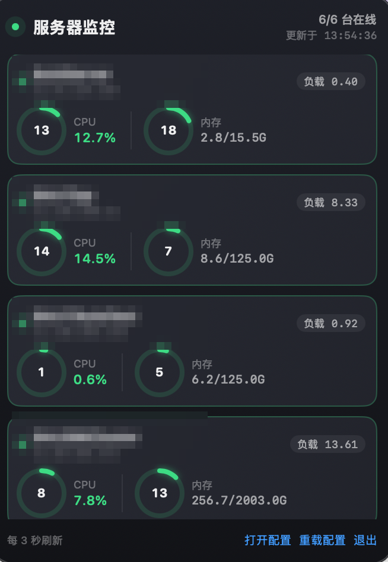

# ServerMonitor

**A macOS menu bar dashboard for monitoring your Linux servers' CPU & memory — zero deployment, just SSH.**

常驻 Mac 菜单栏的服务器监控小工具：自动读取 `~/.ssh/config`，通过 SSH 并行采集所有机器的实时 CPU / 内存 / 负载，点击图标一屏看全。



## 特性

- 🖥 **菜单栏常显**：实时显示全部机器中最高的 CPU% / 内存%，≥70% 变橙、≥90% 变红；鼠标悬停可看摘要
- 📋 **全量一览面板**：每台机器一张卡片——环形仪表、内存用量、1 分钟负载，并行采集互不阻塞
- 🔀 **自适应布局**：机器数量变化时自动重排（≤6 台单列 / 7~14 台双列 / >14 台三列），更多则面板内滚动
- 🧹 **自动去重**：`~/.ssh/config` 多条目指向同一台机器（地址+端口相同）时只显示一个卡片
- 🔔 **故障可见**：失联机器卡片标红并显示原因，面板头部呼吸灯变色、菜单栏追加 ⚠︎
- 🚀 **零部署**：服务器端无需安装任何东西，每次采集只是一条只读 SSH 命令

## 环境要求

- macOS 12+
- 目标服务器为 Linux（读取 `/proc`），且已配置 SSH 免密登录：

```bash
ssh-keygen -t ed25519        # 已有密钥可跳过
ssh-copy-id user@your-server # 输入一次密码
ssh user@your-server         # 确认不再要密码
```

## 安装

**方式一：下载 DMG**（Releases 页面）

打开 DMG，将 ServerMonitor 拖入 Applications。

**方式二：源码构建**

```bash
git clone <repo-url> && cd server-monitor
./build.sh 1.0.0     # 产出 build/ServerMonitor.app 与 build/ServerMonitor-<版本>.dmg
open build/ServerMonitor.app
```

> 开机自启：系统设置 → 通用 → 登录项，添加 ServerMonitor。

## 使用

工具启动后自动读取 `~/.ssh/config` 中的全部 Host 条目并开始监控。例如：

```
Host web                     # 命名别名（推荐写法）
  HostName 203.0.113.10
  User deploy

Host db                      # 同一台机器写了两条？没关系，会自动去重
  HostName 203.0.113.10
  User deploy

Host 203.0.113.30            # 裸 IP 条目也可以，与 HostName 写法等价
  User root
```

自定义配置（可选）— 编辑 app 同目录或源码目录的 `config.json`：

```json
{
  "interval": 3,
  "columns": 0
}
```

| 字段 | 说明 |
|---|---|
| `interval` | 采集间隔（秒） |
| `columns` | 面板列数；`0` = 按机器数自动（≤6:1 列、7~14:2 列、>14:3 列），可填 `1`~`4` 固定 |

往 `~/.ssh/config` 增删机器后，面板内点「重载配置」（⌘R）即生效，无需重启。

## 采集原理

每 `interval` 秒对每台机器并行发起一次 SSH（`ssh 别名`，复用你已有的全部 ssh 配置），在服务器上执行：

```sh
head -1 /proc/stat; sleep 1; head -1 /proc/stat
grep -E '^(MemTotal|MemAvailable):' /proc/meminfo
cat /proc/loadavg
```

- **CPU**：两次 `/proc/stat` 采样差值 → 真实区间占用率（非瞬时值）
- **内存**：`(MemTotal − MemAvailable) / MemTotal`
- **负载**：1 分钟 load average
- 全部为只读命令，对服务器零侵入

## 常见问题

- **面板显示「连接失败」**：鼠标悬停卡片查看具体错误；通常是未配置免密（`Permission denied`）或网络不通。工具使用 BatchMode，不会弹密码框。
- **某台机器没出现**：确认 `~/.ssh/config` 中该条目不是通配符（`Host *` 会被跳过），然后点「重载配置」。
- **同一台机器出现两次？** 不会——地址+端口相同的条目已自动合并，优先保留命名别名。

## 开发

```
main.swift    全部源码（Swift / AppKit / SwiftUI，单文件）
build.sh      构建 + Ad-hoc 签名 + 打包 DMG
config.json   默认配置模板
```

## License

[MIT](LICENSE)
